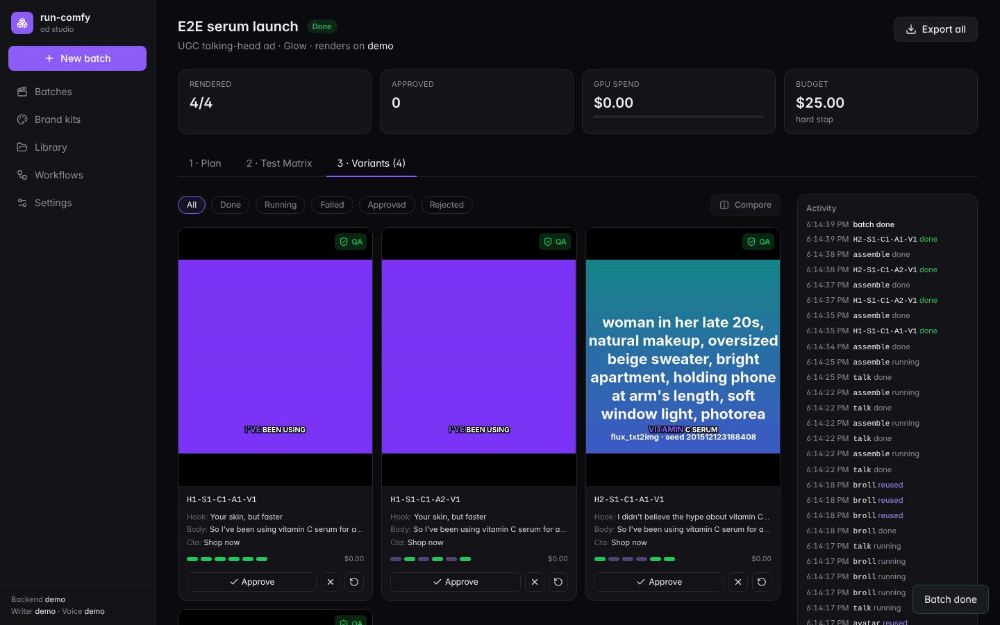
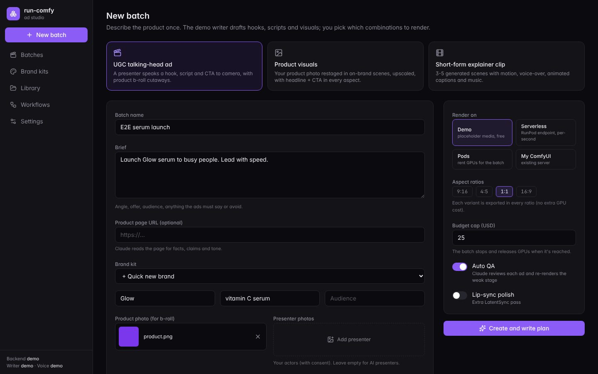
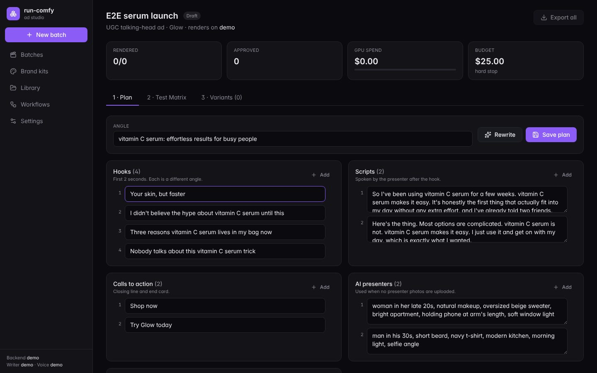
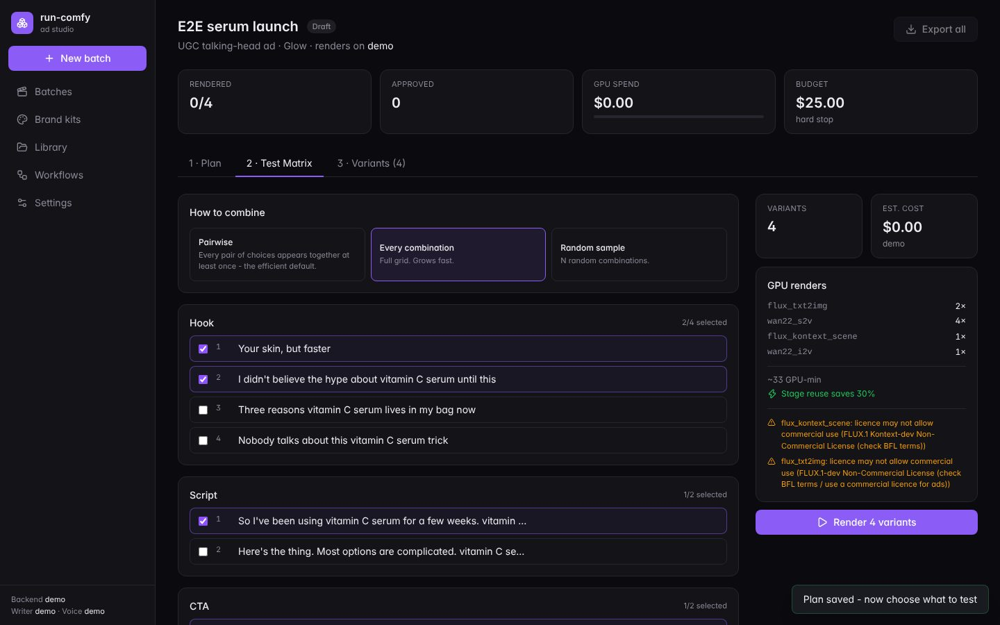

# run-comfy — AI ad & content factory on RunPod + ComfyUI

Turn one product brief into a tested matrix of finished ads: UGC talking-head videos, product
statics and short-form clips, rendered on your own RunPod GPUs. Claude writes the hooks and scripts,
open models do the visuals and voice, and an ffmpeg assembler adds captions, music and end cards.



```bash
python -m venv .venv && .venv/bin/pip install -e '.[dev]'
.venv/bin/python -m run_comfy serve          # dashboard at http://127.0.0.1:8000
```

Out of the box everything runs in **demo mode**: no GPU, no API keys, no cost. Demo mode renders
placeholder media with the real shapes (durations, captions, audio mix, aspect ratios), so you can
try the whole flow before connecting RunPod.

## How a batch works

1. **Brief.** Pick a recipe, a brand kit and a product photo. Add a product URL if you have one;
   Claude reads the page.
2. **Plan.** Claude writes the hooks, scripts, CTAs, presenter descriptions and scene styles. It
   only uses your approved facts and never your banned claims. You can edit any line.
3. **Test matrix.** Choose which hooks × scripts × presenters × voices × styles to test. *Pairwise*
   mode covers every pair of choices with a fraction of the full grid. You see GPU renders, $ cost
   and licence warnings before spending anything.
4. **Render.** Every variant becomes a small pipeline of stages (voice → presenter → talking video →
   b-roll → assembly). Stages are cached by content, so a shared presenter or b-roll clip renders once
   for the whole batch.
5. **QA.** Technical checks (size, duration, -14 LUFS loudness) run on every ad. With an
   `ANTHROPIC_API_KEY`, Claude also scores sampled frames for artifacts and brand violations, and
   re-renders only the stage it blames.
6. **Review and export.** Approve or reject, compare side by side, re-render one stage. Export a zip
   named by variant code (`brand_H2-S1-A3-V1_9x16.mp4`) plus `manifest.csv`, ready for Meta or TikTok
   bulk upload and split-test attribution.

| | | |
|---|---|---|
|  |  |  |

### Recipes

| Recipe | Stages | Test axes |
|---|---|---|
| `ugc`: UGC talking head | voice → presenter (your photo, FLUX, or FLUX+PuLID for one consistent face) → Wan 2.2 S2V talking video → optional LatentSync polish → product b-roll (Kontext restage → Wan 2.2 I2V) → assembly | hook, script, CTA, presenter, voice |
| `product`: static ads | product photo → (cut-out) → FLUX Kontext scene → upscale → headline + CTA + logo in every aspect | scene style, headline, CTA |
| `clip`: short-form explainer | Claude scene list → FLUX keyframes → Wan 2.2 I2V per scene → VO → assembly | hook, visual style, voice, CTA |

Every variant is exported in every aspect ratio you choose (9:16, 4:5, 1:1, 16:9). Re-framing is
done in assembly, so extra ratios add no GPU cost.

## Research: what we took from the best tools

| Source | What they do well | What run-comfy does |
|---|---|---|
| Creatify Batch Mode, Arcads, Higgsfield | One brief → many hook/avatar/CTA variants for A/B tests | Variation matrix with pairwise coverage; axis-coded names and manifest for attribution |
| ComfyDeploy | Versioned workflow deployments | `workflows/<name>/manifest.toml`: content-hash versions, typed inputs |
| RunComfy, fal, Comfy Serverless | Typed inputs instead of raw graphs; async queue; webhooks | Typed and derived inputs (e.g. Wan frame count follows the VO length); Standard-Webhooks events |
| SaladTechnologies/comfyui-api, comfy-pack | Model manifests with hashes; pinned custom nodes | `build-image` (Dockerfile with pinned nodes) and `seed-volume` (sha256-checked model download onto a network volume) |
| runpod-workers/worker-comfyui | Serverless ComfyUI worker | Serverless backend (base64 or S3 outputs) |
| MoneyPrinterTurbo, CapCut-style captioners | Script → VO → subtitles → music | Word-timed animated ASS captions, music ducked under the voice, loudness normalisation |

**Where it goes further:**
- **Stage-level cache.** Changing only the hook re-renders only the voice and talking video. The
  estimate shows the saving before you spend anything.
- **QA re-renders only the failing stage.** It does not redo the whole ad.
- **Your own GPUs, models and cost.** You pay per GPU-second, with no credits and no watermark.
- **Three ways to drive it.** The dashboard, the CLI and an MCP server all drive the same factory.

## Going live on RunPod

1. `cp .env.example .env` and fill in `RUNPOD_API_KEY`. Add `ANTHROPIC_API_KEY` for Claude writing
   and vision QA, `ELEVENLABS_API_KEY` for premium voices, and `HF_TOKEN` for gated FLUX weights.
2. **Models.** Create a RunPod network volume, set `[runpod].network_volume_id` and `data_center_id`,
   then run `python -m run_comfy seed-volume`. It downloads every model listed in the workflow
   manifests onto the volume and terminates its pod.
3. **Image.** Run `python -m run_comfy build-image --base runpod/worker-comfyui:<version>-base`,
   then build and push the Dockerfile. Use the image as `[serverless].image` (then run
   `python -m run_comfy serverless-setup`) or as `[runpod].image` for pods.
4. **Verify the workflow pack.** On a live ComfyUI (a pod's URL), run
   `python -m run_comfy workflows check --url https://<pod>-8188.proxy.runpod.net`. It compares
   every graph with the installed nodes. Fix what it reports, then set `verified = true` in each
   manifest.
5. In the dashboard, pick **Serverless** or **Pods** as the backend and set a budget. The batch stops
   and releases GPUs when the budget is reached.

> **Status:** the engine, factory, dashboard and MCP server are tested end to end against the demo
> backend and simulated ComfyUI and RunPod servers (pytest and Playwright). The ComfyUI graphs in
> `workflows/` follow ComfyUI's core node names and the custom nodes listed in their manifests, but
> they are marked `verified = false` until step 4 passes on a real GPU. Check model licences before
> commercial use: FLUX.1-dev and RMBG-2.0 are non-commercial, and the dashboard warns about them.

## Claude Code integration

`.mcp.json` registers three MCP servers:

| Server | What it's for |
|---|---|
| `run-comfy` (this project, `python -m run_comfy.mcp`) | Create, estimate, render, review and export batches from chat |
| `runpod` (`@runpod/mcp-server`) | Pods, endpoints, templates and volumes |
| `comfy` (official `comfy-mcp`) | Inspect nodes and models on a live ComfyUI (`COMFYUI_URL`), validate and edit workflows |

The project skill `.claude/skills/run-comfy-batch` teaches Claude the batch flow, including asking
for your OK before spending on a paid backend. With the venv active, try *"make 12 UGC variants for
this serum and show me the estimate"*.

## CLI

```bash
python -m run_comfy serve                                   # dashboard + API
python -m run_comfy batch new --recipe ugc --name "Launch" --brief "..." \
    --product product.png --avatar anna.jpg --mode pairwise --n 12 [--run]
python -m run_comfy batch list | status ID | run ID | export ID [--all]
python -m run_comfy workflows list | check --url URL
python -m run_comfy build-image [--bake-models] | seed-volume | serverless-setup | cleanup | gpus
```

### Original bulk CSV pipeline

This still works: one CSV row → one ComfyUI job, on pods or serverless, with resume and budget guards.

```bash
python -m run_comfy validate          # checks workflows/workflow_api.json + jobs.csv, free
python -m run_comfy run [--backend serverless | --url http://host:8188]
```

CSV columns fill `{{column}}` placeholders. A cell that is a local file path is uploaded
automatically, and an empty `seed` means random. Outputs go to `output/`, along with `report.csv`
and `run.log`.

## Configuration

`config.toml` sections:

| Section | Controls |
|---|---|
| `[factory]` | Data dir, default backend (`demo`, `serverless`, `pod`, `url`), budget, QA threshold, caption style, Claude model |
| `[voice]` | `demo`, `elevenlabs`, or `comfy` (your TTS workflow) |
| `[runpod]` / `[serverless]` / `[pipeline]` | GPUs, images, network volume, endpoint, timeouts, restarts |
| `[storage]` | Optional S3 or R2 upload of exports |
| `[webhooks]` | Signed `batch.*` / `variant.completed` events |

## Development

```bash
pytest                                   # ~50 tests on simulated ComfyUI / RunPod / Claude, no cost
cd web && npm install && npm run dev     # dashboard dev server (proxies /api to :8000)
npm run build                            # outputs to run_comfy/web_dist (committed)
RUN_COMFY_URL=http://127.0.0.1:8000 npx playwright test   # e2e against a demo-mode server
```

Layout: `run_comfy/stages.py` (DAG executor and cache) · `backends/` (demo, ComfyUI pod pool,
serverless) · `registry.py` (workflow manifests) · `factory/` (writer, matrix, recipes, captions,
assembly, QA, export, service) · `api.py` · `mcp.py` · `web/` (React dashboard).
